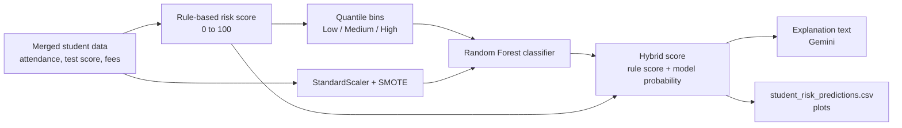

# Student Dropout Risk Prediction System

A hybrid system that scores each student's dropout risk (Low, Medium, High) from attendance, test score and fee burden, using a transparent rule-based score, a Random Forest classifier trained on top of it, and short AI-written explanations of why a student is at risk.

> Built from a problem statement in the **Smart India Hackathon**. This repo is a personal rebuild and extension of that idea.

---

## Problem

Schools usually notice a student has dropped out only after it happens. The warning signs (falling attendance, weak test results, fee pressure at home) exist earlier, but they sit in different places and nobody combines them. Teachers need a simple early-warning list that says **who** is at risk and **why**.

## Proposed solution

1. Combine attendance, test score and fee data for each student.
2. Turn them into an explainable **risk score** (0 to 100) with fixed, readable rules.
3. Group students into **Low / Medium / High** risk.
4. Train a **Random Forest** on the same signals so the model can score new students and give a probability.
5. Blend rule score and model probability into a **hybrid score**.
6. Generate a short plain-language **explanation** of the reasons for each student.

---

## How it works



### Rule-based score

Each signal adds points. The total is capped at 100.

| Signal | Condition | Points |
|---|---|---|
| Attendance rate | below 50% | 35 |
| | 50% to 75% | 25 |
| | 75% or more | 0 |
| Test score | below 40 | 30 |
| | 40 to 70 | 15 |
| | above 70 | 0 |
| Fees (0.1 to 1, higher = more burden) | below 0.4 | 0 |
| | 0.4 to 0.7 | 15 |
| | above 0.7 | 30 |

Risk classes come from the 33rd and 66th percentiles of the score, so the three groups are roughly balanced.

### Model

- **Features:** `Attendance_Rate`, `Test_Score`, `Fees`
- **Target:** the Low / Medium / High class derived from the rule-based score
- **Preprocessing:** `StandardScaler`, then SMOTE to balance classes
- **Classifier:** `RandomForestClassifier` (200 trees, `class_weight="balanced"`)
- **Split:** 80/20, stratified, `random_state=42`

---

## Tech stack

Python, pandas, NumPy, scikit-learn, imbalanced-learn (SMOTE), LightGBM (used automatically only for datasets above 50,000 rows), SHAP, matplotlib, seaborn, Google Gemini (explanations).

---

## Project structure

```
.
├── Dataset/
│   └── merged_students.csv     # merged dataset (500 rows, 21 columns)
├── notebook/
│   └── Dropout.ipynb           # full pipeline: scoring, training, evaluation, plots, explanations
├── src/
│   ├── exception.py            # custom exception with file and line details
│   ├── logger.py               # timestamped log files
│   └── utils.py                # save/load objects, model evaluation helper
├── requirements.txt
├── .gitignore
└── README.md
```

The notebook is the working part of the project and runs on its own. The `src/` helpers are reusable building blocks for a future script-based pipeline and are not imported by the notebook yet.

---

## How to run

### Option 1: Google Colab

1. Upload `notebook/Dropout.ipynb` and `Dataset/merged_students.csv` to Colab.
2. Keep the data path in the loading cell as `/content/merged_students.csv`.
3. Run all cells.

### Option 2: locally

```bash
git clone <this-repo-url>
cd <repo-folder>
python -m venv venv
source venv\Scripts\activate
pip install -r requirements.txt
jupyter notebook notebook/Dropout.ipynb
```

### Output

`student_risk_predictions.csv` with `StudentID`, `Risk_Score`, `Risk_Level`, `Risk_Color`, `Dropout_Reason`, `Dropout_Probability` and `Predicted_Risk_Level`, plus charts for risk distribution, top reasons and attendance by risk level.

---

## Limitations

- The model has not been validated against real dropout outcomes, since the data has none.
- The classification target is derived from the model's own inputs, so the 1.0 scores measure rule reproduction.
- Small, partly synthetic-looking merged dataset with narrow value ranges.
- The hybrid score is a simple average of the rule score and the model's High-risk probability, without calibration.

## Next steps for Improvements

- Train and evaluate on a dataset with real dropout labels, using a time-based or student-based split.
- Split first, then apply SMOTE only to the training set (or drop SMOTE and use class weights).
- Add features that are not part of the rule (income band, parent status, school type) and compare against the rule baseline.
- Use SHAP to show per-student feature contributions in the UI.
